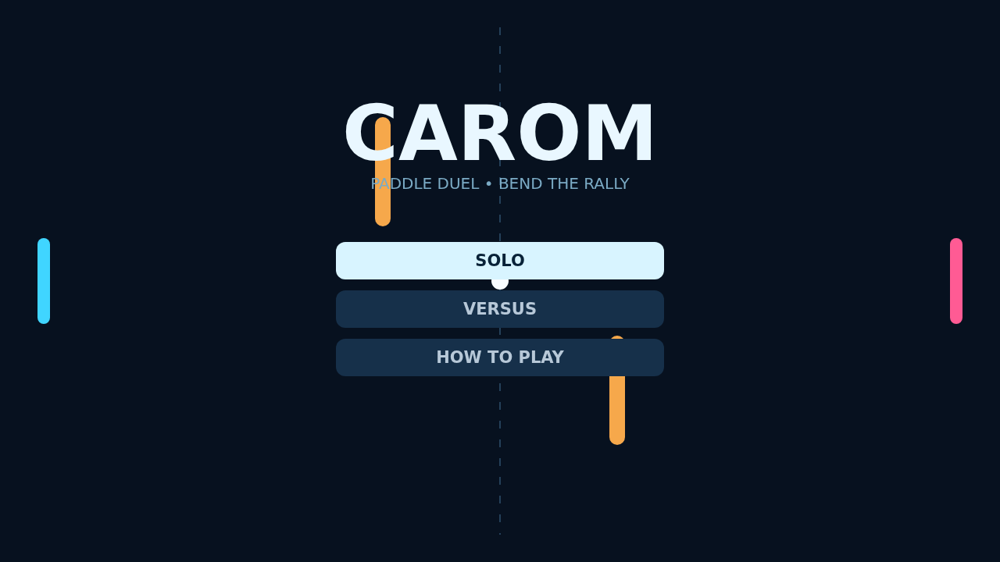

# Carom

Carom begins with a clean serve across a midnight court: blue on the left, pink on the right, and two amber bumpers waiting in the middle. Every rally is quick to read but difficult to master.

Move your paddle as you strike to add curve to the ball. A sharp upward cut can make a straightforward return curl into the wall, while a low swipe turns the bumpers into surprising bank-shot partners.

Solo matches pit you against a responsive defender; Versus turns the same field into a compact local duel. First to eleven, with a two-point lead, owns the table.

